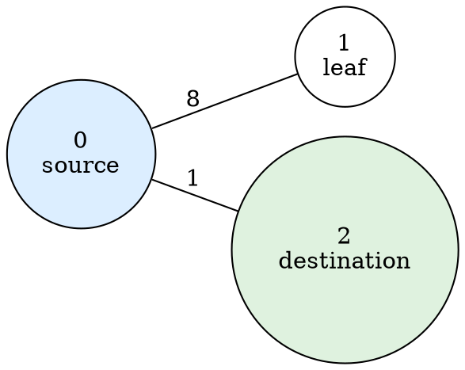

# 1. Initial Directions
## 1.1 Graph-Structural Approaches
- Introduce the initial idea of analysing graph structure rather than relying solely on a shortest-path algorithm.
- Discuss cycles, alternative paths, bridges, dominators and bottlenecks.
- Explain how these properties could indicate potential fragility.
## 1.2 From Structural Metrics to Recovery Costs
- Discuss the initial metric ideas, such as segmentation and early-exit characteristics.
- Explain why structural metrics alone cannot reliably determine the best route.
- Introduce the shift towards explicitly calculating recovery costs.
## 1.3 Proposed Algorithmic Direction
- Introduce the idea of using simple paths to identify recovery alternatives.
- Explain the motivation for developing a multi-stage pipeline.
```latex
\section{Approach}
\subsection{Initial Directions}

\subsubsection{Graph-Structural Approaches}

During the initial stages of the project, we explored whether graph structure could provide a better indication of route fragility than shortest-path selection alone. We considered properties such as cycles, alternative paths, bridges, dominators and bottlenecks to understand how the surrounding graph could affect the consequences of an edge blockage. This led us to recognise that the availability of alternative connections was an important factor in determining route robustness.

\subsubsection{From Structural Metrics to Recovery Costs}
We initially considered structural metrics such as segmentation and early-exit characteristics to describe potential route fragility. However, these metrics mainly described the selected path and could not reliably capture the actual quality or cost of alternative routes. We therefore shifted towards explicitly considering recovery costs, focusing on how much additional travel would be required when an edge became unavailable.

\subsubsection{Proposed Algorithmic Direction}

To investigate recovery costs, we needed a way to identify alternative paths for a selected route. We first considered enumerating simple paths, which provided a direct way to represent possible alternatives but could become computationally expensive. This motivated the development of a path-enumeration tree, which organises partial simple paths into a shared tree structure while preserving their individual path histories. This became the starting point for our subsequent algorithmic investigation.
```

# 2. Preprocessing and Overall Pipeline
Focus on the design and data flow, rather than the detailed mathematical formulation.
```latex
\subsection{Preprocessing and Overall Pipeline}

Our proposed approach uses a preprocessing pipeline to incorporate potential recovery costs into the initial route-selection process. Rather than directly applying a shortest-path algorithm to the original graph, we first construct a representation of possible simple paths and organise the resulting information for efficient access.

The pipeline consists of three main stages:
\begin{enumerate}
    \item \textbf{Path representation}
    Construct a path-enumeration tree to represent possible simple paths while preserving their individual path histories.
    \item \textbf{Recovery-cost computation}
    Use the constructed representation and PathIndex to evaluate potential recovery costs through a modified reverse-Dijkstra procedure.
    \item \textbf{Route selection}
    Use the computed values to guide the selection of an initial route, taking potential edge blockages and their recovery costs into consideration.

\end{enumerate}

% 1. **Path representation:** Construct a path-enumeration tree to represent possible simple paths while preserving their individual path histories.
% 2. **Recovery-cost computation:** Use the constructed representation and PathIndex to evaluate potential recovery costs through a modified reverse-Dijkstra procedure.
% 3. **Route selection:** Use the computed values to guide the selection of an initial route, taking potential edge blockages and their recovery costs into consideration.

The following sections explain each component in detail.
```
## 2.1 Initial Path Enumeration
- Explain why we need to consider multiple simple paths rather than only one shortest path.
- Introduce the enumeration tree and how it represents different path histories.
- Explain how repeated vertices are handled to avoid cycles.
```latex
% We want to understand:
%     \begin{itemize}
%         \item What alternative paths exist from a vertex to the destination?
%         \item How do these paths differ?
%         \item If an edge is blocked, what other routes are available?
%         \item How much recovery cost is associated with choosing a particular route?
%     \end{itemize}
% The issue is that different paths can reach the same vertex through different histories.\\
% A conventional graph stores a node only once.
% This motivated us to investigate an alternative representation that makes different path instances explicit\\

% Simple paths show us alternatives when a blockage is met.\\
% Enumerating simple paths help us compute recovery cost.
% Allows path-specific information to be stored.
% Makes it possible to compare paths that reach the same original vertex through different histories.
\subsubsection{Path Enumeration}
Considering only a single shortest path is insufficient for our problem, as an edge blockage may require finding an alternative route to the destination. We therefore enumerate multiple simple paths (paths that do not revisit vertices) to represent the available alternatives without redundant cycles.

We introduce a Path Enumeration Tree to explicitly represent these paths. Different occurrences of the same original vertex are stored as separate tree nodes, preserving their respective path histories. This also allows us to prevent cycles during enumeration.

The resulting tree is used to construct the Path Index, which groups candidate paths by their first next vertex for subsequent recovery-path selection.
\begin{lstlisting}[caption=Simple Path Tree Construction]
PROCEDURE BuildPathEnumerationTree(G, t):

    root = new TreeNode
    root.vertex = t
    root.cost = 0
    root.history = [t]
    root.parent = NULL

    vertexToTreeNodes[t].append(root)

    EXPAND(root)

    RETURN root, vertexToTreeNodes


PROCEDURE EXPAND(node):

    u = node.vertex

    FOR EACH neighbour v OF u:

        // Prevent cycles: only enumerate simple paths
        IF v IN node.history:
            CONTINUE

        child = new TreeNode

        child.vertex = v
        child.cost = node.cost + w(u, v)
        child.history = node.history + [v]
        child.parent = node

        node.children.append(child)

        vertexToTreeNodes[v].append(child)

        // Recursively expand the new path
        EXPAND(child)

\end{lstlisting}

```
```

PROCEDURE BuildPathEnumerationTree(G, t):

    root = new TreeNode
    root.vertex = t
    root.cost = 0
    root.history = [t]
    root.parent = NULL

    vertexToTreeNodes[t].append(root)

    EXPAND(root)

    RETURN root, vertexToTreeNodes


PROCEDURE EXPAND(node):

    u = node.vertex

    FOR EACH neighbour v OF u:

        // Prevent cycles: only enumerate simple paths
        IF v IN node.history:
            CONTINUE

        child = new TreeNode

        child.vertex = v
        child.cost = node.cost + w(u, v)
        child.history = node.history + [v]
        child.parent = node

        node.children.append(child)

        vertexToTreeNodes[v].append(child)

        // Recursively expand the new path
        EXPAND(child)

```

## 2.2 Constructing the PathIndex
- Explain how paths are grouped by their first hop.
- Describe how this allows us to identify alternative paths when a particular outgoing edge is blocked.
- Explain how recovery-cost information is extracted from these groups.

```latex
\subsubsection{Path Index}
Although the Path Enumeration Tree represents all candidate simple paths, searching through the entire collection for recovery alternatives can be inefficient. We therefore construct a $Path Index$ to organise these paths by their first next vertex. Specifically, $pathIndex[u][v]$ stores all candidate paths from vertex $u$ to destination $t$ that begin with edge $(u,v)$. This grouping allows us to efficiently exclude paths containing a blocked first edge and retrieve alternative candidates during recovery-path selection.

\begin{lstlisting}[caption=Path Index construction]
PROCEDURE BuildPathIndex(vertexToTreeNodes, t):

    INITIALISE empty pathIndex

    FOR EACH vertex u IN vertexToTreeNodes:

        FOR EACH node IN vertexToTreeNodes[u]:

            // The node stores the path from t to u
            // Reverse it to obtain a candidate path from u to t
            path = REVERSE(node.history)

            // Destination has no further edge to traverse
            IF u == t:
                CONTINUE

            // First vertex after u determines the group
            v = path[1]

            pathIndex[u][v].append(path)

    RETURN pathIndex
\end{lstlisting}
```

```
PROCEDURE BuildPathIndex(vertexToTreeNodes, t):

    INITIALISE empty pathIndex

    FOR EACH vertex u IN vertexToTreeNodes:

        FOR EACH node IN vertexToTreeNodes[u]:

            // The node stores the path from t to u
            // Reverse it to obtain a candidate path from u to t
            path = REVERSE(node.history)

            // Destination has no further edge to traverse
            IF u == t:
                CONTINUE

            // First vertex after u determines the group
            v = path[1]

            pathIndex[u][v].append(path)

    RETURN pathIndex

```
## 2.3 Overall Pipeline
Show the complete process:
Original weighted graph

Input graph, source s and destination t


Simple-path enumeration tree

Generate possible simple paths


PathIndex and recovery-cost information

Organise alternatives by first hop


Route selection

Use recovery information to select an initial route


You can introduce the route-selection stage here, but leave its mathematical formulation for Section 4.

```latex
\subsubsection{Conclusion of preprocessing}
<!-- show graph -->
Before the path-selection stage, we perform preprocessing to construct a representation of the candidate simple paths between each vertex and the destination. This consists of two stages: constructing the Path Enumeration Tree to explicitly represent distinct path histories, followed by building the Path Index to organise candidate paths by their first next vertex. The resulting index provides an efficient lookup structure for retrieving alternative paths and filtering out candidates affected by blockages during subsequent recovery-path selection.
```
# 3. Critical Evaluation of the Preprocessing Pipeline
Discuss whether the preprocessing is necessary and how it could be improved.
- Is the enumeration tree necessary, or could dynamic programming avoid repeated suffixes?
- Could we store only the two cheapest alternatives with distinct first hops?
- Could recovery costs be computed directly using edge-deleted shortest paths or replacement-path techniques?
- What are the efficiency trade-offs?
This section evaluates the preprocessing independently of whether the final selection formulation is correct.
```latex
\subsection{Questioning the Current Approach}

\subsubsection{Questioning the Path Enumeration Tree}

Can we construct the Path Index without explicitly enumerating every simple path?
The Path Enumeration Tree provides a way to represent different path histories,
but its construction can be expensive due to the potentially exponential number
of simple paths.

We also observed repeated substructures in the tree. However, these do not
necessarily correspond to equivalent subproblems that can be merged. Different
path histories may contain different visited vertices and accumulated costs,
meaning that merging them could lose information required to maintain simple
paths. As a result, we were unable to formulate a useful dynamic programming
approach using a sufficiently compact state representation.

\textbf{Future Direction:} Investigate whether the Path Index can be constructed
directly, without first generating the full Path Enumeration Tree.

\subsubsection{Questioning the Path Index}

Do we actually need to store every candidate path?
Assuming reversed Dijkstra is an appropriate approach for calculating recovery
costs, we can question whether the Path Index stores more information than
necessary.

Our primary concern is the recovery cost after an edge blockage. Complete path
histories are useful for reconstructing the actual route, but storing every
possible candidate path may be unnecessarily expensive. For a given vertex
$u$, perhaps we only need to retain:

\begin{itemize}
    \item The shortest path from $u$ to $t$.
    \item The best alternative path that avoids the first edge of the shortest
          path.
\end{itemize}

This raises the possibility of maintaining only two candidate paths per vertex,
rather than every simple path. However, this requires further investigation.
In particular, we need to establish whether the second-shortest path is
sufficient for every possible blocked edge, or whether different blocked edges
require different alternatives.

\textbf{Future Direction:} Investigate a more compact Path Index that stores only
the necessary recovery information, potentially reducing its storage
requirements from an exponential number of paths to a small number of candidates
per vertex.

\subsubsection{Questioning the Overall Pipeline}

Can the current multi-stage process be simplified or replaced?
Our current approach separates the problem into several stages:

\begin{enumerate}
    \item Enumerate simple paths using the Path Enumeration Tree.
    \item Organise candidate paths using the Path Index.
    \item Calculate recovery costs using reversed Dijkstra.
    \item Select an appropriate path based on the resulting information.
\end{enumerate}

Although each stage has a specific purpose, the overall process introduces
additional computational and storage overhead. This raises a broader question:
are all these stages necessary, or can we derive the required recovery
information more directly from the original graph?

\textbf{Future Direction:} Investigate whether a more integrated approach can
calculate the necessary recovery costs and identify alternative paths without
explicitly constructing all intermediate representations.
```
# 4. Route Selection Formulation and Correctness
This is where I would put the mathematical core of the project.
## 4.1 Current Route-Selection Formulation
Start by explaining what the selection problem is trying to achieve.

For each possible next hop \(v\) from \(u\), there are two outcomes:
1. The edge succeeds, and the traveller continues from \(v\).
2. The edge is blocked, and the traveller uses a recovery path.
Then introduce the current recurrence:
\[
Q(u,v)=\max\left(w(u,v)+dist[v],R(u,v)\right)
\]

\[
dist[u]=\min_{v\in N(u)}Q(u,v)
\]

Explain the intuition behind the minimax choice and how the modified reverse-Dijkstra procedure calculates these values.
```latex
\subsection{Route Selection Formulation and Correctness}
\subsubsection{Current Route-Selection Formulation}
The selection problem aims to determine the next hop that minimises the worst-case travel cost from the current vertex $u$ to the destination $t$.\\ 
For each candidate neighbour \(v\), two outcomes are considered: if the edge $(u,v)$ succeeds, the traveller pays $w(u,v)$ and continues with the optimal cost $dist[v]$; if it is blocked, the traveller incurs a recovery cost $R(u,v)$ to reach an alternative route. Therefore, the cost of selecting $v$ is defined as
$$Q(u,v)=\max\left(w(u,v)+dist[v],R(u,v)\right)$$
, and the optimal choice is
$$dist[u]=\min_{v\in N(u)}Q(u,v)$$.
The maximum operator accounts for the worse of the two possible outcomes, while the minimum operator selects the neighbour with the lowest worst-case cost.\\
This minimax recurrence is evaluated using a modified reverse-Dijkstra procedure,\\
which processes vertices in increasing order of their calculated costs,\\
propagating the optimal values from the destination towards the source.
```

## 4.2 Correctness of Recovery Costs
- Why grouping paths by their first hop correctly identifies alternatives.
- Why excluding a blocked first hop gives the appropriate recovery path.
- Relationship between \(R(u,v)\) and the shortest path in \(G-\{u,v\}\).
```latex
\subsubsection{Correctness of Recovery Costs}
Grouping paths according to their first hop provides a systematic way to identify alternative routes from the current vertex $u$ to the destination $t$. Any two paths with different first hops represent distinct initial routing choices. Therefore, when the selected edge $(u,v)$ is blocked, valid recovery paths must belong to groups whose first hops differ from $v$. Excluding the blocked edge ensures that the recovery path does not rely on the unavailable connection. Consequently, the recovery cost is equivalent to the shortest-path distance in the graph with the blocked edge removed:

$$
R(u,v)=d_{G-\{(u,v)\}}(u,t)
$$.

This equivalence holds because every valid path from $u$ to $t$ in $G-\{(u,v)\}$ avoids the blocked edge, and the shortest such path gives the minimum recovery cost. Under the assumption that an alternative $u \to t$ path exists, $R(u,v)$ is therefore well-defined and finite. If no such path exists, the recovery cost is infinite, indicating that selecting $(u,v)$ cannot guarantee reaching the destination under the considered blockage scenario.
```
## 4.3 Correctness of the Selection Procedure
Separate two questions:
- Does modified reverse-Dijkstra correctly calculate the values defined by the recurrence?
- Do those recurrence values actually represent the optimal strategy for the traveller?
The first may be provable using the label-setting property. The second is more difficult.

```latex
% 4.3: Correctness of the Selection Recurrence
\subsubsection*{Correctness of the Selection Recurrence}

Consider the recurrence
\[
Q(u,v)=\max\left(w(u,v)+D(v),R(u,v)\right),
\qquad
D(u)=\min_{v\in N(u)}Q(u,v),
\qquad D(t)=0.
\]
This result is a claim about the calculation of the recurrence, not about whether the recurrence contains enough information to describe the traveller's complete history.

For a fixed neighbour $v$, define
\[
F_{u,v}(x)=\max\left(w(u,v)+x,R(u,v)\right).
\]
The function $F_{u,v}$ is non-decreasing in $x$. Since every edge weight is positive,
\[
F_{u,v}(x)\geq w(u,v)+x>x.
\]
Therefore, a candidate value propagated from $v$ to $u$ is strictly greater than the value of $v$.

Suppose that $u$ is the next vertex settled by modified reverse-Dijkstra but that $dist[u]$ is greater than its recurrence value $D(u)$. By
\[
D(u)=\min_{v\in N(u)}Q(u,v),
\]
there is some neighbour $v$ attaining $D(u)$. We have
\[
D(v)<Q(u,v)=D(u),
\]
because edge weights are positive. Thus $v$ must have been settled before $u$. When $v$ was settled, the algorithm examined $(u,v)$ and assigned $u$ a candidate no greater than $D(u)$, which contradicts the assumption that $u$ was settled with a larger value.

Conversely, every relaxation corresponds to a valid choice of $v$, so the algorithm cannot assign a value smaller than $D(u)$. Induction on the priority-queue settlement order therefore gives $dist[u]=D(u)$ for every settled vertex.

\noindent\textbf{Conclusion.} Modified reverse-Dijkstra correctly computes the values of the stated recurrence, provided that $R(u,v)$ is finite and correct.

\subsubsection*{Whether the recurrence represents the optimal strategy}

The recurrence is valid only if the success and failure cases for $(u,v)$ can be combined into one state from $v$. In the success case, the traveller knows that $(u,v)$ is open. In the failure case, the traveller knows that $(u,v)$ is blocked and begins recovery. The current recurrence uses the unconditioned value $D(v)$ in the success case, so it does not carry this known-open information forward.

As a result, the claim that the recurrence globally represents the optimal strategy is not established. The next subsection gives a valid counterexample under the problem assumptions.

\noindent\textbf{Conclusion.} The recurrence solver is correct, but recurrence correctness does not imply optimality for the history-dependent traveller.
```

## 4.4 History-Dependent State Issue
Discuss the potential problem with using only \(dist[v]\).

After successfully traversing \(u-v\), the traveller knows that edge is open. However, \(dist[v]\) does not remember that history and may account for a failure scenario involving the same edge.

Discuss whether this causes overestimation or a suboptimal decision, and whether a richer state is required.

```latex
% 4.4: History-Dependent State Counterexample and State Refinement
\subsubsection*{History-Dependent State Counterexample}

The claim that $dist[v]$ remains valid after $(u,v)$ is confirmed open is not established. The following counterexample also satisfies all valid assumptions of the problem: the graph is connected and undirected, edge weights are positive, and at most one edge may be blocked.

Let the vertex set be $V=\{0,1,2\}$ and let $t=2$. The edges are $(0,1)$ with weight $8$ and $(0,2)$ with weight $1$.

\begin{figure}[h]
\centering
\fbox{\parbox{0.55\linewidth}{\centering\textbf{[Insert generated Graphviz image here]}\\$G$ with source $0$, leaf $1$, and destination $2$.}}
\caption{Counterexample graph for the history-dependent state issue.}
\label{fig:history-state-counterexample}
\end{figure}

If the traveller is at vertex $1$ before any edge is known open, the only available neighbour is $0$. If $(1,0)$ is blocked, vertex $1$ is isolated and cannot reach $t$. Hence
\[
R(1,0)=\infty,
\qquad D(1)=\infty
\]
in the unconditioned recurrence.

Now suppose the traveller reaches vertex $1$ by successfully traversing $(0,1)$. Edge $(0,1)$ is known open. From vertex $1$, the traveller may return along $(1,0)$, pay $8$, then traverse $(0,2)$, pay $1$. This gives
\[
D(1\mid (0,1)\text{ known open})
\leq 8+1=9.
\]
It follows that
\[
D(1)=\infty
\quad\text{but}\quad
D(1\mid (0,1)\text{ known open})\leq 9.
\]
The infinite value at $1$ included a possible failure of $(1,0)$, but that edge cannot fail after $(0,1)$ has been confirmed open. This is a feasible and valid history-dependent state, not a contradiction in the arithmetic of the recurrence.

\noindent\textbf{Conclusion.} Using only $D(v)$ can be either overconservative or incorrect, because $D(v)$ is computed without the confirmed-open edge information; the overconservative result can also exclude a feasible state.

\subsubsection*{Future Work: State Refinement}

One possible direction for future work is to refine the state so that it records edges already confirmed open. Let $S$ denote this set and let $D(u,S)$ denote the proposed worst-case cost from vertex $u$ under that knowledge state. A candidate edge $(u,x)$ could then be treated in two forms:
\[
D(u,S)=\min_{x\in N(u)}
\begin{cases}
w(u,x)+D(x,S), & (u,x)\in S,\\
\max\left(w(u,x)+D(x,S\cup\{(u,x)\}),R(u,x)\right), & (u,x)\notin S,
\end{cases}
\]
with $D(t,S)=0$.

If $(u,x)$ is already open, the traveller considers only the successful branch. If $(u,x)$ has not been confirmed open, the traveller still considers the maximum of the successful and blocked outcomes, and adds $(u,x)$ to the known-open set after a successful traversal.

This proposed formulation would replace the current recurrence's use of $D(v,\varnothing)$ with the history-aware value $D(v,S\cup\{(u,v)\})$, rather than representing the history-dependent state with $dist[v]$ in the current implementation.

\noindent\textbf{Conclusion.} A future history-aware formulation could investigate whether tracking known-open edges is sufficient to prove and compute an optimal traveller strategy; the current project has not implemented or proved this refined state model.
```


<!-- ## 4.5 Competitive Ratio
Introduce the offline optimum and compare the online strategy against it.

Be careful to distinguish minimising worst-case absolute cost from minimising the worst-case competitive ratio. Also, explain whether your current formulation establishes any competitive guarantee. -->
# 5. Complexity Analysis
Analyse the components separately:
- Enumeration tree: potentially exponential in the number of vertices.
- PathIndex construction and storage.
- Recovery-cost lookup.
- Modified reverse-Dijkstra: potentially \(O((n+m)\log n)\) with efficient recovery-cost access.
Then state that the overall pipeline remains exponential because of simple-path enumeration.
```latex
\section{Complexity Analysis}

The computational complexity of the proposed pipeline is analysed by considering the enumeration tree, PathIndex construction, recovery-cost lookup, and modified reverse-Dijkstra procedure separately.

\paragraph{Enumeration Tree Construction.}

The enumeration tree represents all simple paths originating from the source vertex \(s\). In the worst case, a graph may contain exponentially many simple paths. For a complete graph with \(n\) vertices, the number of simple paths from a fixed source can grow factorially with \(n\). Therefore, the enumeration tree may require exponential time and space in the number of vertices.

\paragraph{PathIndex Construction and Storage.}

PathIndex groups the enumerated paths according to their first hop, allowing alternative paths to be identified efficiently. Since every enumerated path must be processed at least once, its construction takes time proportional to the total size of the enumerated paths. Similarly, its storage requirement depends on the total number of stored path entries, which can also grow exponentially in the worst case.

\paragraph{Recovery-Cost Lookup.}

Once PathIndex has been constructed, alternative paths can be retrieved by accessing the corresponding first-hop groups. Excluding the group associated with a blocked edge identifies the remaining candidate paths. If the paths and their costs are stored appropriately, retrieving the minimum recovery cost requires examining the relevant alternatives, or can be reduced to constant-time lookup with suitable preprocessing. The exact complexity therefore depends on the chosen indexing and storage structure.

\paragraph{Modified Reverse-Dijkstra.}

The modified reverse-Dijkstra procedure processes vertices and relaxes candidate transitions using the recurrence
$$
Q(u,v)=\max\left(w(u,v)+dist[v],R(u,v)\right).
$$
Assuming that recovery costs can be accessed in constant time, each edge is considered a constant number of times. Using a priority queue, the procedure has a time complexity of
$$
O((n+m)\log n),
$$
where \(n=|V|\) and \(m=|E|\). This bound assumes that the label-setting property holds and that recovery-cost lookup does not introduce additional computational overhead.

\paragraph{Overall Complexity.}

Although the modified reverse-Dijkstra procedure can be implemented efficiently, the overall pipeline remains exponential in the worst case due to the enumeration of all simple paths during enumeration tree construction and PathIndex preprocessing. Consequently, the preprocessing stage, rather than the selection procedure itself, represents the primary computational bottleneck of the proposed approach.
```
# 6. Significance, Limitations and Future Work
- Significance of incorporating recovery costs into initial route selection.
- Limitations of the enumeration-based preprocessing.
- Unresolved history-dependent state issue.
- Whether the current formulation can be proven globally optimal.
- Potential improvements through more efficient recovery-cost computation and richer state representations.
```latex
\section{Significance, Limitations and Future Work}

\paragraph{Significance of the Proposed Approach.}

This investigation explores how recovery costs can be incorporated into the initial route-selection process for the Canadian Traveller Problem. Unlike conventional shortest-path approaches that primarily consider the cost of successfully traversing a planned route, the proposed formulation also considers the potential cost of recovering from a blocked edge. This provides a different perspective on route selection, where the quality of a route depends not only on its initial travel cost but also on the availability and cost of alternative routes. Although the current formulation does not establish a globally optimal strategy, it provides a theoretical starting point for investigating how graph structure and recovery costs can influence route selection.

\paragraph{Limitations of Enumeration-Based Preprocessing.}

The proposed approach uses an enumeration tree to represent simple paths and a PathIndex structure to organise alternative routes by their first hop. While this provides a systematic way to identify recovery paths, the number of simple paths can grow exponentially with the graph size. Consequently, the preprocessing stage introduces significant time and space overhead, limiting the scalability of the approach. Future work could investigate more efficient alternatives, such as replacement-path algorithms, graph decomposition, and structural analysis using dominators and biconnected components, to identify recovery routes without explicitly enumerating every simple path.

\paragraph{History-Dependent State Limitation.}

Another unresolved limitation concerns the representation of the traveller's state. The current recurrence uses a single value \(dist[v]\) to represent the future cost from each vertex, without recording previously traversed edges. However, successfully traversing an edge provides information that changes the set of possible blockage scenarios. Therefore, the current formulation may overestimate future costs or produce suboptimal decisions by failing to account for this information. A richer state representation, such as \(dist[v,S]\), where \(S\) records edges already confirmed as available, could address this limitation. However, maintaining such states may substantially increase the computational complexity.

\paragraph{Global Optimality.}

Although the modified reverse-Dijkstra procedure can potentially establish the values defined by the proposed recurrence, this does not automatically prove that the resulting strategy is globally optimal for the original problem. In particular, the history-dependent state issue leaves a gap between correctly evaluating the recurrence and correctly modelling the traveller's optimal decisions. Further theoretical work is required to establish whether the current formulation can be proven optimal under additional assumptions or whether a fundamentally different state representation is necessary.

\paragraph{Future Research Directions.}

Several directions remain open for further investigation. First, recovery-cost computation could be improved through more efficient replacement-path techniques and graph-structural preprocessing, reducing the dependence on exhaustive simple-path enumeration. Second, richer state representations could be explored to account for information acquired during traversal. Third, alternative formulations could investigate whether the selection problem admits a more efficient solution while retaining the ability to account for recovery costs. Finally, formal competitive analysis could be used to compare the resulting strategies against established approaches, such as Backtrack, under the same blockage assumptions.

\paragraph{Concluding Remarks.}

Although the proposed approach does not yet provide a proven globally optimal solution, the investigation identifies several important challenges in incorporating recovery costs into initial route selection. In particular, it distinguishes the computational correctness of solving a recurrence from the more fundamental question of whether that recurrence accurately represents the traveller's decision-making process. The exploration of enumeration trees, PathIndex construction, and modified reverse-Dijkstra also provides insight into the trade-offs between representing alternative routes explicitly and computing them efficiently. Importantly, identifying the limitations of these approaches helps narrow down the conditions under which they are applicable and highlights potential directions for future research. These findings can serve as a starting point for subsequent investigations into more scalable and theoretically sound fragility-aware routing strategies.
```